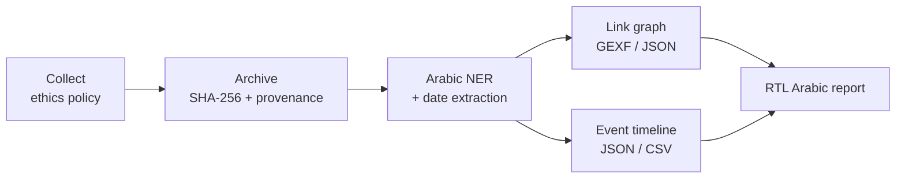

<div align="center">

# 🔎 Arabic OSINT Link-Analysis

**An ethics-first pipeline that turns public Arabic social-media posts into verifiable link graphs and event timelines.**

<br>


[Quick start](#-quick-start) ·
[Features](#-features) ·
[Sample output](#-sample-output) ·
[Usage](#-usage) ·
[How it works](#-how-it-works) ·
[Limitations](#-limitations)

</div>

---

## Overview

Collect **publicly available** Arabic-language content, extract the people,
places and organizations in it, and map how sources and events connect, so
claims can be **triangulated** across independent sources instead of trusted
from one.

Every item is archived with a **SHA-256 hash**, a **UTC collection timestamp**
and full **source provenance**. Anyone can re-verify the archive later and detect
a single altered byte.



## ✨ Features

| | |
|---|---|
| 🛡️ **Ethics enforced in code** | Non-public items are dropped, empty text is rejected, requests are rate-limited, and RSS feeds honour `robots.txt` |
| 🔐 **Tamper-evident archive** | Content-addressed blobs plus an append-only manifest. `verify` flags tampered, missing and malformed entries |
| 🧠 **Arabic NER, always available** | CAMeL Tools, AraBERT/CAMeLBERT, or a built-in rule-based backend that works with no model and no network |
| 📅 **Deterministic date extraction** | Levantine/Iraqi months (شباط، آذار…), Gregorian transliterations (فبراير، مارس…), Arabic-Indic digits, `dd/mm/yyyy`, `yyyy-mm-dd`, bare years. Invalid dates like 31/02 are rejected |
| 🕸️ **Link analysis** | Entity co-occurrence graph with degree and betweenness centrality, communities, and distinct-source counts. Opens directly in **Gephi** |
| 🧭 **Triangulation** | Every entity and every date shows how many *independent* sources mention it |
| 📰 **RTL Arabic report** | `report.html` plus machine-readable `report.json`, with all dynamic content HTML-escaped |
| 🔌 **Flexible ingestion** | Maps many export field names (`text`/`content`/`full_text`/`tweet`, `id_str`/`post_id`, `screen_name`…) so different platform exports load as-is |

## 🛡️ Ethics and scope

The guardrails are enforced in `osint_pipeline/collectors/base.py`
(`EthicsPolicy`), not just documented:

| Guardrail | Behaviour |
|-----------|-----------|
| **Public content only** | Items flagged `private`, `protected` or any non-public `visibility` are dropped |
| **Non-empty text** | Items with no text after trimming are dropped |
| **Rate limiting** | `--min-delay` sets the minimum seconds between source requests |
| **Volume cap** | `--max-items` stops collection after N items |
| **`robots.txt`** | The RSS collector skips feeds that disallow access |
| **Provenance** | Source URL, author, publish time, collection time, collector and SHA-256 on every item |

The pipeline does **not** impersonate users, bypass access controls or attempt
to re-identify anyone. The primary collector reads **local exports** (the shape
of official research and export APIs), which keeps runs reproducible and avoids
scraping.

## 🚀 Quick start

```bash
git clone https://github.com/aajarad/Arabic-OSINT-link-Analysis.git
cd Arabic-OSINT-link-Analysis

python -m venv .venv
.venv\Scripts\activate            # macOS / Linux: source .venv/bin/activate

pip install -r requirements.txt   # core only: networkx

python -m osint_pipeline run --collector file \
    --source data/samples/arabic_posts.jsonl \
    --output output --ner-backend rule
```

Then open **`output/report.html`** for the summary and load
**`output/link_graph.gexf`** in [Gephi](https://gephi.org/).

> **Tip:** `--ner-backend rule` gives a deterministic, offline run. With the
> default `auto`, the pipeline tries model backends first and may try to
> download a checkpoint if `transformers` is installed.

## 📊 Sample output

Running the bundled 10-post sample (`data/samples/arabic_posts.jsonl`):

```text
collected 10   archived 10   entities 49   timeline events 10
graph: 21 nodes · 58 edges · 4 communities · density 0.276
archive integrity: 10/10 verified
```

**Top entities by triangulation** (how many distinct sources mention them):

| Entity | Type | Sources | Mentions |
|--------|------|:------:|:--------:|
| حلب | LOC | **4** | 7 |
| الأمم المتحدة | ORG | **3** | 4 |
| الهلال الأحمر | ORG | **3** | 3 |
| وزارة الصحة | ORG | 2 | 2 |
| دمشق | LOC | 2 | 3 |

**Timeline** (`timeline.csv`, opens cleanly in Excel):

```csv
date,precision,date_origin,source,item_id,entities,snippet
2023-02-06,day,text,'@sana_news,p001,الأمم المتحدة; حلب; دمشق; وزارة الصحة,أعلنت وزارة الصحة في دمشق أن الأمم المتحدة أرسلت قافلة...
```

## 📦 Installation

The core runtime needs only `networkx` and works fully offline. Python 3.9+.

```bash
pip install -r requirements.txt
```

Optional extras, as requirements files or package extras (`pip install ".[models]"`):

| Extra | File | Adds |
|-------|------|------|
| `models` | `requirements-models.txt` | `transformers` + `torch` for AraBERT / CAMeLBERT NER |
| `camel` | `requirements-camel.txt` | CAMeL Tools `NERecognizer` |
| `rss` | `requirements-rss.txt` | `feedparser` for the RSS collector |
| `dev` | `requirements-dev.txt` | `pytest` |

## 🧰 Usage

```bash
# Full pipeline over a local JSON / JSONL export
python -m osint_pipeline run --collector file \
    --source data/samples/arabic_posts.jsonl --output output

# Use a specific transformers checkpoint
python -m osint_pipeline run --collector file --source <path> \
    --ner-backend transformers --ner-model CAMeL-Lab/bert-base-arabic-camelbert-mix-ner

# Collect from RSS / Atom feeds (needs the rss extra)
python -m osint_pipeline run --collector rss --feeds https://example.com/feed.xml

# Re-verify an archive at any later time
python -m osint_pipeline verify --archive output/archive

# Show collectors and which NER backends are actually available here
python -m osint_pipeline info
```

<details>
<summary><b><code>run</code> options</b></summary>

<br>

| Flag | Default | Description |
|------|---------|-------------|
| `--collector` | `file` | `file` or `rss` |
| `--source` | – | Path to a JSON/JSONL export (file collector) |
| `--feeds` | – | One or more RSS/Atom URLs (rss collector) |
| `--output` | `output` | Output directory |
| `--archive-dir` | `<output>/archive` | Where the archive is written |
| `--labels` | `PERSON LOC ORG` | Entity labels included in the graph |
| `--ner-backend` | `auto` | `auto`, `rule`, `camel` or `transformers` |
| `--ner-model` | – | Override the model checkpoint |
| `--max-items` | unlimited | Stop after N accepted items |
| `--min-delay` | `0` | Minimum seconds between source requests |

**Exit codes:** `0` success · `1` runtime error or failed `verify` · `2` usage
error · `3` missing source file.

</details>

<details>
<summary><b>Python API</b></summary>

<br>

```python
from osint_pipeline import Pipeline, PipelineConfig

summary = Pipeline(PipelineConfig(ner_backend="rule", output_dir="output")).run(
    "file", path="data/samples/arabic_posts.jsonl"
)
print(summary["graph"]["top_by_triangulation"][:3])
```

The stages also work on their own: `Pipeline.collect()` and `Pipeline.process()`.

</details>

<details>
<summary><b>Input format</b></summary>

<br>

The file collector accepts a JSON array, JSONL, or a JSON object wrapping a
list (for example `{"data": [...]}`), as UTF-8 with or without a BOM. Malformed
JSONL lines are skipped with a warning and counted. A minimal record:

```json
{"id": "p001", "platform": "twitter", "author": "@sana_news",
 "url": "https://example.org/sana/1", "created_at": "2023-02-07T09:15:00Z",
 "visibility": "public",
 "text": "أعلنت وزارة الصحة في دمشق أن الأمم المتحدة أرسلت قافلة مساعدات إلى حلب يوم 6 شباط 2023"}
```

</details>

## 🗂️ Outputs

Written to `--output` (default `output/`):

| File | Description |
|------|-------------|
| `archive/manifest.jsonl` | Append-only audit log, one line per item with hash and provenance |
| `archive/blobs/…` | Content-addressed copies named by SHA-256, sharded by the first two hex characters |
| `link_graph.gexf` | Entity co-occurrence network, **opens directly in Gephi** |
| `link_graph.json` | Same graph as node-link JSON with centrality, community and source counts |
| `timeline.json`, `timeline.csv` | Events grouped by date with source counts |
| `report.html`, `report.json` | RTL Arabic run summary |

## ⚙️ How it works

<details>
<summary><b>Collect and archive</b></summary>

<br>

Collectors implement a single `_fetch()` method. `BaseCollector` applies the
ethics policy, rate limiting and provenance stamping uniformly. Each item is
written once as a blob named by its SHA-256; every item still gets its own
manifest line, so the archived count and the blob count can differ when content
repeats. `verify` re-hashes every blob against the manifest.

</details>

<details>
<summary><b>Arabic NER and dates</b></summary>

<br>

`ArabicNER(backend="auto")` tries CAMeL Tools, then transformers, then the
rule-based backend, and reports which one is in use. All backends emit `PERSON`,
`LOC` and `ORG`. `DATE` entities always come from the deterministic extractor,
so the timeline never depends on a model being installed.

The rule backend matches multi-word gazetteer names longest-first (including
names with attached prefixes such as `بدمشق`) and treats honorific cues
(الرئيس، الوزير، الدكتور…) followed by a few tokens as a person.

Normalization strips diacritics and tatweel and unifies alef, ya, ta marbuta and
hamza variants. It is used for matching and de-duplication only; reports always
show the original surface form.

</details>

<details>
<summary><b>Graph, triangulation and timeline</b></summary>

<br>

Nodes are keyed `LABEL:normalized`; edges join entities that co-occur in a
document, weighted by how often. Each node counts the **distinct sources** that
mention it, so a claim seen across many independent sources ranks higher in
`top_by_triangulation` than one seen once.

Timeline events are anchored to dates found in the text. The item's `published`
timestamp is used only when the text contains no date. Events are grouped by
date, with a `source_count` showing how many independent sources converge on
the same moment.

</details>

## 🧱 Project layout

```text
osint_pipeline/
├── cli.py          command-line interface
├── pipeline.py     orchestration (Pipeline, PipelineConfig)
├── collectors/     ethics policy, file and RSS collectors, registry
├── archive/        content-addressed, tamper-evident archive
├── nlp/            NER dispatcher, backends, dates, gazetteers
├── graph/          co-occurrence graph, GEXF / JSON export
├── timeline/       date-anchored event timeline, JSON / CSV export
├── report/         RTL Arabic HTML / JSON report
└── utils/          Arabic normalization, hashing, time helpers
data/samples/       sample inputs (synthetic)
tests/              pytest suite
```

## ✅ Testing

```bash
pip install -r requirements-dev.txt
python -m pytest -q
```

The suite covers hashing and normalization, ethics filtering, archive tamper
detection, NER backends (using fake models, so nothing is downloaded), date
extraction, graph triangulation, timeline grouping, the CLI, and full end-to-end
runs including HTML escaping and empty inputs.

## ⚠️ Limitations

- The rule-based NER is gazetteer- and cue-driven. It is deterministic and
  offline, but misses names that are not in the gazetteers and have no cue word.
  Use a model backend for broader recall.
- The CAMeL and transformers backends are unit-tested with fake models; they
  have not been validated against real checkpoints in this repository.
- Co-occurrence is not evidence of a relationship. Treat graph edges as leads to
  verify, not conclusions.
- The sample data under `data/samples/` is synthetic.

## 🤝 Responsible use

Intended for research, journalism, human-rights documentation and defensive
analysis of **public** information. Do not use it to target, harass or identify
private individuals, and comply with the terms of service and laws that apply to
the sources you analyse.
